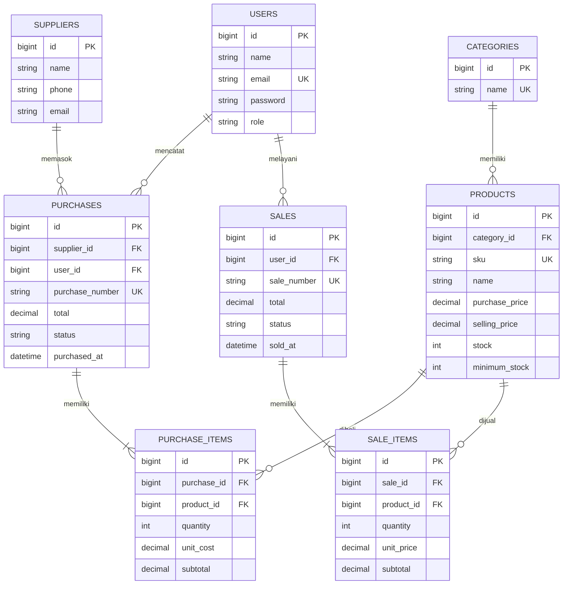

# ERD InvenTrack

## Entity Relationship Diagram

## Penjelasan Relasi

1. **Categories – Products:** satu kategori dapat memiliki banyak produk.
2. **Suppliers – Purchases:** satu supplier dapat memiliki banyak transaksi pembelian.
3. **Users – Purchases:** satu pengguna dapat mencatat banyak transaksi pembelian.
4. **Purchases – Purchase Items:** satu transaksi pembelian memiliki satu atau lebih detail barang.
5. **Products – Purchase Items:** satu produk dapat tercatat dalam banyak detail pembelian.
6. **Users – Sales:** satu pengguna dapat mencatat banyak transaksi penjualan.
7. **Sales – Sale Items:** satu transaksi penjualan memiliki satu atau lebih detail barang.
8. **Products – Sale Items:** satu produk dapat tercatat dalam banyak detail penjualan.

**Keterangan:** PK = Primary Key, FK = Foreign Key, UK = Unique Key.
